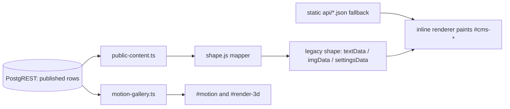

# Front-end playbook for a CMS-driven single-page site

Technical documentation for a production front end built as one HTML page, without a
framework: two hand-written modules, a hanging-print media gallery with spring physics,
eight themes on one variable layer, and the browser gates that protect the layout.

The subject is the architecture, not one particular website. The screenshots come from a
reference implementation running on a local demo dataset, so every number below can be
traced to a file and a line.

| | |
|---|---|
| **27 screenshots** | every section, eight themes, mobile, both media galleries, two extra entry points |
| **2 screen recordings** | the gallery being dragged, and all eight themes cycling |
| **15 documents** | about 4,300 lines of cited engineering notes |
| **3 reference tables** | DOM hooks, CSS tokens, QA handles |
| **1 capture tool** | regenerates every image, with a redaction gate |

---

## Architecture

One `index.html` holds the whole public page: markup, design tokens, a Tailwind CDN
config, and a large inline renderer that paints CMS content into `#cms-*` containers.
Two TypeScript modules load as ES modules:

- `src/cms/public-content.ts` reads published rows over PostgREST and hands them to
  `src/cms/shape.js`, a pure mapper that produces the shape the renderer expects.
- `src/gallery/motion-gallery.ts` implements the hanging-print carousel and serves both
  `#motion` (video) and `#render-3d` (stills).

Everything else is CSS, one spring integrator, and puppeteer tests.

Two constraints shape most of the code:

- The public page loads Tailwind from a CDN, so no plugin can be registered and the
  typography plugin never runs. Markdown is styled by a hand-written `.md-body` block.
- The galleries are laid out from measured widths, not fixed sizes, which is what keeps
  portrait and landscape media on the same clothesline.

## Contents

| Document | Subject |
|---|---|
| [SKILL.md](SKILL.md) | Agent playbook: layers, invariants, hook map, verification protocol, pitfall shortlist |
| [docs/ARCHITECTURE.md](docs/ARCHITECTURE.md) | Entry points, module graph, boot sequence, fallback layers, build pipeline |
| [docs/RENDERING.md](docs/RENDERING.md) | Rows to legacy shape to DOM: mapper, description grammar, sanitiser, carousel and modal |
| [docs/GALLERIES.md](docs/GALLERIES.md) | Layout math, drag, breeze physics, rotation, reduced motion |
| [docs/DESIGN-SYSTEM.md](docs/DESIGN-SYSTEM.md) | Colour roles per theme with computed contrast ratios, type scale, spacing, elevation |
| [docs/COMPONENTS.md](docs/COMPONENTS.md) | Section-by-section inventory: DOM contract, source field, states, rendering range |
| [docs/THEMING.md](docs/THEMING.md) | Token layers and the Tailwind CDN constraint |
| [docs/ACCESSIBILITY.md](docs/ACCESSIBILITY.md) | Current behaviour and the measured gaps, each with the smallest fix |
| [docs/PERFORMANCE.md](docs/PERFORMANCE.md) | File sizes, animation budgeting, font strategy, improvement list |
| [docs/SEO-AND-META.md](docs/SEO-AND-META.md) | Every head tag, the JSON-LD block, the domain change checklist |
| [docs/COOKBOOK.md](docs/COOKBOOK.md) | Twelve worked changes, each with its verification command |
| [docs/EXTRA-ENTRIES.md](docs/EXTRA-ENTRIES.md) | The two standalone pages that share the build |
| [docs/BUILD-AND-DEPLOY.md](docs/BUILD-AND-DEPLOY.md) | Scripts, entry points, Cloudflare Pages, custom domain verification |
| [docs/TESTING.md](docs/TESTING.md) | Node suites and puppeteer gates, and what each proves |
| [docs/PITFALLS.md](docs/PITFALLS.md) | Numbered failures with the symptom each prevents |
| [references/](references/) | DOM hooks, CSS tokens per theme, QA handles for browser tests |
| [tools/capture.mjs](tools/capture.mjs) | Regenerates every screenshot and clip |
| [LISTING.md](LISTING.md) | Package summary: contents, coverage, terms |
| [CHANGELOG.md](CHANGELOG.md) | Release history |

## Screenshots

### The page

| | |
|---|---|
|  |  |
|  |  |
|  |  |

### The gallery

Higher quality: [gallery-drag.mp4](docs/media/gallery-drag.mp4), 2.3 seconds, 172 KB.

A drag swings the whole clothesline. Each print keeps its own phase of ambient breeze, and
the active print stays exactly still because the breeze amplitude is gated by how active
the print is. The clip is a recording of the component, not a mockup.

### Eight themes

| | | | |
|---|---|---|---|
|  |  |  |  |
|  |  |  |  |

Higher quality: [theme-cycle.mp4](docs/media/theme-cycle.mp4), 6.1 seconds, 596 KB.

Each theme is a variable block, so no component holds a colour. A ninth theme is four
edits, listed in the cookbook.

### Mobile

| | | |
|---|---|---|
|  |  |  |

## Measured findings

Recorded while documenting the code. Each entry names the file that owns the fix; none of
these is inferred from a screenshot.

- **29 of the 47 colour aliases in the Tailwind config resolve to an undefined variable.**
  Nav links and the hero button hover to `primary-fixed-dim`, one of the empty aliases, so
  those hovers never change colour (`docs/DESIGN-SYSTEM.md`).
- **One of the eight themes fails contrast.** The sand accent `#d4af37` on its cream
  surface measures 1.94:1. The other seven pass for body text; four fail for filled
  buttons (`docs/DESIGN-SYSTEM.md`, `docs/ACCESSIBILITY.md`).
- **The work modal is not a dialog.** No `role`, no `aria-modal`, no focus move, no trap,
  no Escape handler and no focus restore. The image lightbox implements the complete
  pattern and is the model to copy (`docs/ACCESSIBILITY.md`).
- **The closed mobile menu stays in the tab order.** It is translated off screen instead
  of hidden, so its links and eight theme buttons remain keyboard reachable
  (`docs/ACCESSIBILITY.md`).
- **The icon font is 4.0 MB, the document is 195 KB before gzip, and first paint waits on
  a 2.9 second timer chain.** All three numbers are measured (`docs/PERFORMANCE.md`).
- **The deploy folder carries 36 MB of unreferenced images and 11 MB of models.** No page
  references them (`docs/PERFORMANCE.md`).

## Reading order

An agent should load `SKILL.md` first, then the single topic document that matches the
change, then `references/*` for exact identifiers, then `docs/PITFALLS.md` before
declaring the change complete.

For a human reader the useful entry points are the screenshots, then
`docs/ARCHITECTURE.md`, then the topic that matches the work. `docs/COOKBOOK.md` maps
common changes to a diff and a verification command.

## Conventions

- Citations are `path:line` relative to the site repository root, for example
  `src/gallery/motion-gallery.ts:947`. When a line has drifted, search for the cited
  identifier.
- Content is referred to as "CMS rows". The production domain and the hosting project
  name do not appear in the text.
- Diagrams are mermaid code fences and render on GitHub.
- "Renderer" means the inline `<script>` at `index.html:1542-2289`. "Gallery" means
  `src/gallery/motion-gallery.ts`. "Shape" means `src/cms/shape.js`.

## Scope

This repository documents the public front end. The admin dashboard, the database schema,
the RLS policies and the migration tooling are in
[supabase-portfolio-cms](https://github.com/fachrur1/supabase-portfolio-cms), together
with a credential-free demo harness that reproduces the build used for these captures.

## Requirements

Node 20 or newer, and Puppeteer available where `tools/capture.mjs` runs. The
documentation itself has no build step.

## Licence

MIT. The text, diagrams and reference tables may be reused in any project, commercial or
not. Attribution is appreciated, not required.

The captures in this repository were taken from a local build with demo content.
