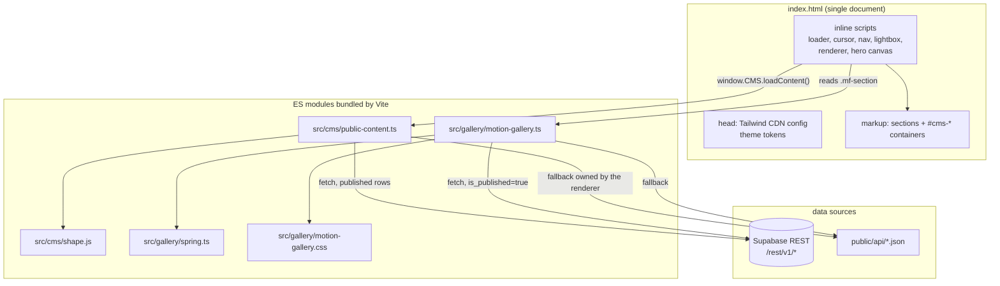
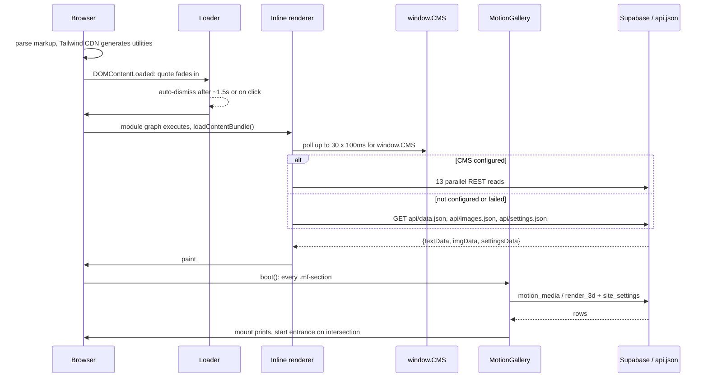
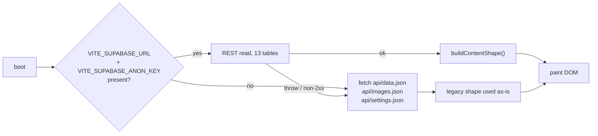

# Architecture

The public site is one HTML document that boots three independent layers: a
cinematic loader, a CMS renderer, and a CMS-driven gallery. Nothing is
server-rendered. Everything the visitor sees is either static markup or painted
into a container by JavaScript after a fetch.

## 1. Entry points

Vite builds four HTML entries. Only the first one is the portfolio page.

| Entry | File | Role |
|---|---|---|
| `main` | `index.html` | the public single-page portfolio |
| `suitability` | `suitability-land-for-RE/index.html` | standalone demo page, own inline JS + Chart.js CDN |
| `meet` | `meet/index.html` | standalone demo page, own inline JS + daily-js CDN |
| `admin` | `admin/index.html` | the content dashboard SPA (backend repository's subject) |

Declared in `vite.config.ts:19-24`. The two demo entries share nothing with
`index.html` except the Tailwind CDN and the font stack: no module imports, no
`#cms-*` containers, no gallery.

`oji/` is a separate Astro experiment on the same branch. It has its own
`package.json`, its own Cloudflare Pages workflow (`.github/workflows/deploy-oji.yml`)
and is not part of the root Vite build. The public page never loads it. Treat it
as a parallel prototype, not as a second front-end of this site.

## 2. Module graph



Three import edges exist in the whole front-end: `public-content.ts -> shape.js`
(`src/cms/public-content.ts:20`), `motion-gallery.ts -> spring.ts` and
`motion-gallery.ts -> motion-gallery.css` (`src/gallery/motion-gallery.ts:15-16`).
The renderer is not a module. It is a classic inline script
(`index.html:1542-2289`) that talks to the two modules through globals:
`window.CMS` (`src/cms/public-content.ts:145`) and the `.mf-section` DOM.

## 3. Boot sequence



Ordering facts that matter:

- The loader is click-to-continue and also self-dismisses: one quote, a 1500 ms
  timer, then `hideLoader()` (`index.html:1470-1536`). `#app-content` starts as
  `opacity-0 pointer-events-none` (`index.html:949`) and is revealed by the
  loader (`index.html:1487-1491`).
- The hero typewriter is defined by the renderer (`index.html:1913`) but started
  by the loader (`index.html:1492`). Both paths are guarded:
  if the loader is already gone when content arrives, the renderer starts the
  animation itself (`index.html:1927-1930`).
- The renderer polls for `window.CMS` instead of assuming module order
  (`index.html:1769-1771`). Modules and inline scripts are not ordered relative
  to each other in a way you can rely on.
- The gallery does not wait for the renderer. It boots from its own module
  (`motion-gallery.ts:1584-1590`) and only reads `.mf-section` elements.

## 4. Fallback layers



| Layer | Lives in | Fails how |
|---|---|---|
| Env check | `src/cms/public-content.ts:28-30` | returns false, loader throws `CMS not configured` (`public-content.ts:129-131`) |
| REST read | `src/cms/public-content.ts:32-44` | non-2xx becomes an `Error`; the renderer catches and warns (`index.html:1773-1778`) |
| Static JSON | `index.html:1779-1790` | a missing `settings.json` is tolerated (`catch(() => null)`) |
| Gallery data | `motion-gallery.ts:331-366` | live CMS first, then `api/motion.json` / `api/render3d.json`, then an empty bundle |
| Empty section | `motion-gallery.css:33` | section stays `display:none`, no broken clothesline |

The static JSON layer is not a legacy leftover to delete: it is what makes the
page work with no backend at all, and it is what the smoke test exercises
(`tests/public-smoke.mjs:8-11`). `public/api/*.json` is generated, not authored:
`scripts/build-cms.ts` copies `content/*.json` into `public/api/` on every dev
start and every build (`scripts/build-cms.ts:116-130`).

## 5. File map

| Path | Lines | Responsibility |
|---|---|---|
| `index.html` | 2986 | page, tokens, inline renderer, ~15 small behaviours |
| `src/cms/public-content.ts` | 145 | Supabase REST loader, CV link rewrite, `window.CMS` |
| `src/cms/shape.js` | 491 | pure mapper: rows -> legacy shape (shared with tests and migration) |
| `src/gallery/motion-gallery.ts` | 1593 | the hanging-print carousel, both sections |
| `src/gallery/motion-gallery.css` | 689 | `mf-*` styles, scoped tokens, rotation, reduced motion |
| `src/gallery/spring.ts` | 103 | spring integrator, clamps, easing, hash |
| `scripts/build-cms.ts` | 133 | content -> `public/api/*.json` |
| `vite.config.ts` | 99 | four entries, dev-only CMS plugin |
| `tailwind.config.js` | 91 | PostCSS-era config, **not** used by the CDN page |
| `src/main.ts`, `src/style.css` | 1, 3 | vestigial Vite scaffold, referenced by neither `index.html` nor `vite.config.ts` |

`tailwind.config.js` and `src/style.css` are dead weight for the public page:
the page configures Tailwind in a `<script id="tailwind-config">` block
(`index.html:102-179`) because the CDN build cannot read a config file. Keep the
two configs in sync if you change tokens, or delete the unused one deliberately.

## 6. What the build produces

`npm run build` writes `dist/` after clearing it (`vite.config.ts:10-11`):

```text
dist/index.html                 script tags rewritten to /assets/main-*.js + main-*.css
dist/assets/main-*.js           public-content + motion-gallery + inline renderer bundle
dist/assets/main-*.css          emitted from motion-gallery.css
dist/api/*.json                 copied from public/ (Vite copies public/ verbatim)
dist/admin/, dist/meet/, dist/suitability-land-for-RE/
```

`three` and its addon paths are marked external (`vite.config.ts:13-18`), so the
build never bundles a 3D renderer into the public page. Any code that needs
`three` must load it from a URL, not from a bare import.

## 7. What is deliberately absent

- No client router. Navigation is anchor scrolling (`index.html:2498-2510`) plus
  a `history.pushState` 500 ms after the scroll.
- No state management. The only persisted state is the theme name in
  `localStorage` (`index.html:2303`, `2332`).
- No animation library. See `spring.ts:1-9` for the reasoning that is still in
  force.
- No SSR, no hydration, no partials. The single page is the unit of deployment.