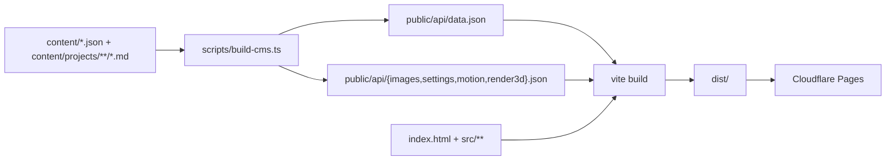

# Build and deploy

Two commands matter: `npm run dev` and `npm run build`. Both run the content
generator first, then Vite. Deployment is Cloudflare Pages serving `dist/`.

## 1. Scripts

From `package.json`:

| Script | Command | Use |
|---|---|---|
| `dev` | `tsx scripts/build-cms.ts && vite` | local development on port 3000 |
| `build` | `tsx scripts/build-cms.ts && vite build` | produce `dist/` |
| `preview` | `vite preview` | serve the built output locally |
| `typecheck` | `tsc --noEmit` | type gate, no emit |
| `test:cms` | `node --test tests/shape.test.mjs tests/admin-*.test.mjs ...` | unit suites (shape plus admin helpers) |
| `test:gallery` | `node tests/render3d-gallery.mjs` | one gallery browser gate |
| `cms:migrate`, `cms:admin`, `cms:verify` | node scripts | database side, backend repository's concern |

There is no `prebuild` hook. The content step is chained inline with `&&`, so a
failing `build-cms.ts` aborts the build (correct, and the reason the chain is not
split into two scripts that callers might run separately).

## 2. Build pipeline

### 2.1 `scripts/build-cms.ts`

- Paths are resolved from `process.cwd()` (`scripts/build-cms.ts:6-10`), so run it
  from the repository root.
- It ensures `public/api/` exists (`:12-15`).
- **Monolithic content wins.** If `content/data.json` exists, it is copied
  verbatim to `public/api/data.json` and the modular path is skipped entirely
  (`:20-26`). Editing `content/core/*.json` then has no effect. Check which mode
  is active before debugging "my content change did nothing".
- Modular mode assembles `hero`, `about`, `contact`, `education`, `skills`,
  `organizations`, `photography` from `content/core/*.json`,
  `content/experience/organizations.json` and `content/media/photography.json`
  (`:28-65`), then walks `content/projects/**/*.md`, converts frontmatter into
  meta lines and appends the markdown body (`:71-107`), sorts by numeric file
  prefix and drops the helper field (`:109-112`).
- Sidecar files `images.json`, `settings.json`, `motion.json`, `render3d.json`
  are copied from `content/` to `public/api/` (`:122-130`). A missing sidecar is
  skipped, not an error.
- It writes into the working tree, not into a temp directory. A dirty
  `public/api/*.json` after a build is expected.

### 2.2 `vite build`

| Setting | Value | Citation |
|---|---|---|
| dev port | 3000 | `vite.config.ts:6-8` |
| outDir | `dist` | `vite.config.ts:10` |
| emptyOutDir | true | `vite.config.ts:11` |
| external | `three`, `three/addons/loaders/OBJLoader.js`, `MTLLoader.js`, `OrbitControls.js` | `vite.config.ts:13-18` |
| entries | `index.html`, `suitability-land-for-RE/index.html`, `meet/index.html`, `admin/index.html` | `vite.config.ts:19-24` |

`public/` is copied verbatim into `dist/`, which is how `dist/api/*.json` and
`dist/assets/*` become reachable at the same relative paths the page fetches.

The output for the main entry is one JS bundle plus one CSS file, with hashed
names in `dist/assets/`. The inline renderer is bundled into that JS file; the
page keeps only the Tailwind CDN tag and the module script tag in `dist/index.html`.

## 3. The dev-only plugin (read this before using `/api/save`)

`vite.config.ts:28-97` registers a `configureServer` middleware that exists only
in `npm run dev`. It provides:

| Endpoint | Effect |
|---|---|
| `POST /api/save` | writes `content/*.json` **and** `public/api/*.json`, then answers 200 |
| `POST /api/upload` | decodes a base64 data URL, writes a timestamped file into `public/assets/images/` |

Two hazards, both real:

1. After a successful save it shells out to
   `npm run build && git add . && git commit && git push && npx wrangler pages deploy ...`
   (`vite.config.ts:51`). Hitting that endpoint from a dev session can publish to
   production. Do not call it in an automated loop, and do not leave a dev server
   exposed.
2. `configureServer` is dev only, so the endpoint does not exist in `dist/` or on
   Cloudflare Pages. Nothing in production depends on it.

## 4. Deploying to Cloudflare Pages

| Item | Value | Where it is defined |
|---|---|---|
| Build command | `npm run build` | this document, matching `package.json` |
| Output directory | `dist` | `vite.config.ts:10` |
| Production branch | `main` | the deploy command passes `--branch main` (`vite.config.ts:51`) |
| Pages project name | pinned in the deploy command | `vite.config.ts:51` (kept out of these docs on purpose) |
| Custom domain | the origin in the canonical and Open Graph tags | `index.html:8-21` |

Two supported paths:

- **Direct upload.** `npm run build` then `npx wrangler pages deploy dist` with the
  project name and `--branch main`. This is exactly what the dev plugin does
  (`vite.config.ts:51`), so it is the path with in-repo evidence.
- **Git integration.** Point the Pages project at the repository, branch `main`,
  build command `npm run build`, output `dist`. The repository has no root
  `wrangler.toml` or `wrangler.jsonc`, so nothing else has to be configured.

Environment variables: `VITE_SUPABASE_URL` and `VITE_SUPABASE_ANON_KEY` must be
present at **build** time, because Vite inlines them
(`src/cms/public-content.ts:24-26`, `src/gallery/motion-gallery.ts:127-130`).
Set them in the Pages project settings, not only in a local `.env`. Builds
without them still succeed and the site falls back to `api/*.json`
(`index.html:1772-1790`), which is a useful property: a misconfigured production
build silently serves stale static content rather than breaking.

## 5. Verifying a deploy

The build is static, so verification is four checks, in order:

1. `dist/index.html` references hashed assets and no `src/main.ts` path.
2. The deployed origin returns 200 for `/`, `/api/data.json` and
   `/assets/<hash>.js`.
3. The custom domain (the origin in `index.html:8`) serves the same build as the
   `*.pages.dev` hostname. A domain that lags behind is a DNS or custom-domain
   attachment issue, not a build issue.
4. Open the deployed page once with a hard reload and confirm the hero text and
   the works counter render. Both come from the CMS layer, so they prove the
   fetch path, not just the HTML.

Automated option: `TARGET=https://<deployed-host>/ node tests/render3d-gallery.mjs`
runs the gallery gate against a remote origin (`tests/render3d-gallery.mjs:17`).
It is read-only and safe against production.

## 6. What is not deployed by this repository

- The database migration and admin bootstrap scripts (`scripts/migrate-to-supabase.mjs`,
  `scripts/bootstrap-admin.mjs`, `scripts/verify-cms.mjs`) are local tools. They
  need a service-role key and must never run in CI.
- `oji/` has its own workflow (`.github/workflows/deploy-oji.yml`) and its own
  Pages project. It only triggers on changes under `oji/**` on `main`.
- There is no CI job for the root site. If you want one, the gate sequence is
  `npm run typecheck`, `npm run build`, `node tests/public-smoke.mjs`.

## 7. Rollback

Cloudflare Pages keeps every deployment, so the fastest rollback is promoting the
previous deployment in the dashboard. Reverting a commit does not roll back the
site by itself unless the project builds from git, and even then the rebuild has
to finish. Do not "roll back" by editing `dist/` locally; `emptyOutDir` and the
hash in asset names make a partial copy worse than no copy.