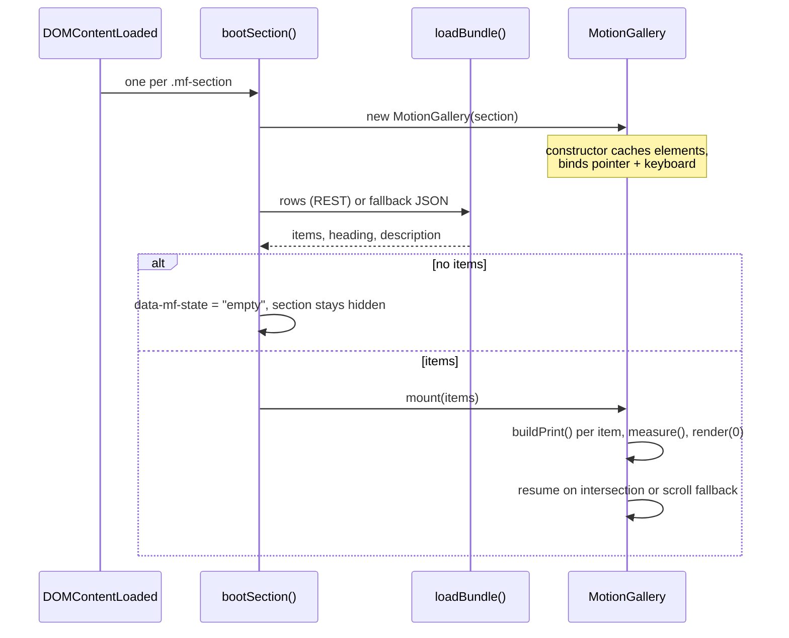

# Galleries

One class, `MotionGallery` (`src/gallery/motion-gallery.ts:372`), renders both
hanging-print carousels on the page: `#motion` for video and `#render-3d` for
stills. The design is a clothesline of prints, one peg at a time, with the
neighbouring prints drifting in still air.

## 1. Two sections, one implementation

| | `#motion` | `#render-3d` |
|---|---|---|
| Markup | `index.html:1137-1171` | `index.html:1176-1210` |
| Selector attribute | none (default `motion`) | `data-mf-source="render3d"` |
| Table | `motion_media` | `render_3d` |
| Fallback JSON | `api/motion.json` | `api/render3d.json` |
| Copy keys | `motion_heading`, `motion_description` | `render3d_heading`, `render3d_description` |
| Row mapper | `normalize()` (`motion-gallery.ts:168-193`) | `normalizeRender()` (`motion-gallery.ts:206-226`) |
| Media | video file or embed, poster image | still image only, no play control |
| QA handle | `window.MotionFrames` | `window.RenderFrames` |

Source selection is two lines: `SOURCE_CONFIG`
(`motion-gallery.ts:313-328`) and `section.dataset.mfSource`
(`motion-gallery.ts:1525`). A third gallery is a config entry plus markup, never
a second class.

Both sections sit between photography and organizations, in that order
(`index.html:1134-1210`). A regression test asserts that position and that the
navigation was not extended with gallery links
(`tests/motion-gallery.mjs:616-620`).

## 2. Section contract

The markup is a fixed skeleton. The class queries it by attribute, so a renamed
element breaks the gallery at construction time, not at render time.

| Element | Attribute | Used for |
|---|---|---|
| section | `data-mf-state="empty"` | hidden until content exists (`motion-gallery.css:33`) |
| stage | `data-mf-stage` | pointer surface, `tabindex="0"`, `role="group"` |
| SVG line | `.mf-line-svg > .mf-line-path` + two `.mf-pin` | clothesline, redrawn in `measure()` |
| track | `.mf-track` | all prints are appended here |
| skeleton | `data-mf-skeleton` | removed on first mount |
| cursor label | `.mf-cursor` | `Drag` / `Play` hint on fine pointers |
| controls | `data-mf-prev`, `data-mf-next`, `data-mf-counter` | buttons and `01 / 06` readout |
| ticks | `data-mf-ticks` | one `<button class="mf-tick">` per print |
| live region | `data-mf-live` | polite announcement on navigation |
| copy | `data-mf-heading`, `data-mf-description` | optional CMS copy targets |

`applyCopy()` falls back to the `#cms-motion-heading` / `#cms-motion-description`
ids (`motion-gallery.ts:1517-1522`), which is why `#motion` carries both
mechanisms and `#render-3d` only carries the data attributes.

## 3. Lifecycle



`mount()` (`motion-gallery.ts:444-547`) does the whole reset: clears the track,
drops the skeleton, sets `data-mf-state="ready"`, builds prints and ticks, sets
`loop` when there are at least three prints (`:477`), measures, then computes
each print's target width and renders one frame.

## 4. Layout math

All geometry is derived at mount and on every resize. Nothing is hardcoded in
pixels except small budgets.

Inputs (`measure()`, `motion-gallery.ts:785-848`):

| Symbol | Source | Default |
|---|---|---|
| `w` | `stage.clientWidth` | 1024 fallback |
| `lineTop` | `--mf-line-top` on `.mf-section` | 66px (44px under 860px) |
| `sag` | `--mf-sag` | 30px (22px under 860px) |
| `captionH` | `--mf-caption-h` | 58px |
| `vh` | `window.innerHeight` | 800 fallback |
| `CHROME` | `PAD * 2 + 2` = 22px | paper padding plus border |

The derived values:

```text
narrow      = w < 900
budget      = clamp(vh * (narrow ? 0.72 : 0.84), 380/460, 620/820)
maxMediaH   = max(150, budget - lineTop - sag - 16 - captionH - CHROME)
maxInnerW   = w * (narrow ? 0.76 : 0.46)
inner(v)    = min(maxMediaH * v.ratio, maxInnerW)
step        = clamp((widest + CHROME) * 0.7 + (narrow ? 58 : 88), 200, w * 0.78|0.68)
height      = clamp(lineTop + sag + tallest + CHROME + captionH + 16, 300, budget)
```

Three consequences of changing a number:

1. The stage height is written back to the element (`:828-830`) and re-read on the
   next `measure()`. The vertical budget therefore comes from the viewport, not
   from `clientHeight`, otherwise the measurement would feed back on itself
   (`motion-gallery.ts:793-796`).
2. `step` is the horizontal distance between neighbouring print origins. Drag
   maps pixels to index through it (`onDragMove`, `:1245`), so a change here
   changes drag sensitivity.
3. Print width is `inner * (0.82 + 0.18 * activity) + CHROME`
   (`targetWidth`, `:850-854`). The active print is 100% of its allowance; a
   print two steps away is 82%.

The clothesline is an SVG quadratic curve whose control point doubles the sag
(`:838-841`), and `lineY(x)` reproduces the same curve as a parabola so each
print can be pinned to the line (`:856-863`). Prints hang from their top edge:
`transform-origin: 50% 0` (`motion-gallery.css:196`) and `y = lineY(center + x) - 2`
(`:904`).

## 5. Pointer, drag and click

| Concern | Implementation | Reason |
|---|---|---|
| Native image drag | `draggable="false"` on posters, `-webkit-user-drag: none` in CSS, plus `dragstart` cancelled on the stage | otherwise the browser starts a drag-and-drop ghost and the carousel never sees the gesture (`motion-gallery.ts:606-609`, `1171-1174`, `motion-gallery.css:203-218`) |
| Gesture lifetime | `pointerdown` on the stage, `pointermove`/`pointerup`/`pointercancel` on `window` | survives leaving the stage without `setPointerCapture` (`:1205-1210`) |
| Why not capture | capturing retargets the following `click`, so the play and fullscreen buttons never fire | stated in the source comment at `:1205-1207` and covered by `tests/render3d-gallery.mjs:243-247` |
| Drag threshold | 5px before `moved` flips and `mf-dragging` is added | a tap must not count as a drag (`:1237-1241`) |
| Follow | `value = startProgress - dx / step`, 1:1 | (`:1245-1248`) |
| Bounded mode | `softClamp` rubber band beyond the ends | `spring.ts:15-19` |
| Release | project momentum `value + velocity * 0.16`, then `goTo(round())` | (`:1281-1288`) |
| Click after drag | `suppressClick` consumed by a capture-phase click listener | (`:1177-1186`, `1280`) |
| Click without drag | selects the print under the pointer, else focuses the stage | (`:1272-1278`) |
| Video controls | pointer gestures ignored on `.mf-video`, `.mf-frame`, `.mf-full` | native controls own them (`:1192`) |
| Touch scrolling | `touch-action: pan-y` on the stage, `auto` on video and iframe | vertical page scroll still works (`motion-gallery.css:149`, `271-272`) |

Keyboard (stage scoped, `:1136-1166`): `ArrowLeft` / `ArrowRight` navigate,
`Home` / `End` jump, `Enter` / `Space` re-select the focused print. Inputs and
modified keys are ignored so the gallery never eats a shortcut.

Roving tabindex keeps the DOM tab order honest: only the active print and its two
buttons are tabbable (`:1119-1125`).

## 6. Ambient breeze

The wind is the whole reason the gallery does not read as a static slider. It is
three slow sines with per-print phases, scaled by distance from the peg.

Constants (`motion-gallery.ts:105-110`):

```text
WIND_ROT = 2.2   deg of sway at the far edge
WIND_DX  = 2.6   px of horizontal drift along the line
WIND_DY  = 2.0   px of vertical bob
```

Amplitude and signals (`breezeOf`, `:947-972`):

```text
amp   = (1 - activity) ^ 1.35          // activity = 1 - |distance from peg|
sway  = 0.50 sin(0.51t + p1) + 0.42 sin(0.97t + p2)
      + 0.12 sin(0.23t + p3) + 0.08 sin(2.2t + p4)
drift = 0.55 cos(0.51t + p1) + 0.38 cos(0.97t + p2)
bob   = 0.60 sin(0.83t + p2) + 0.40 cos(0.51t + p1)

rot = sway * WIND_ROT * amp
dx  = drift * WIND_DX  * amp
dy  = bob   * WIND_DY  * amp
```

Properties that must survive any change:

- The active print gets **exactly** zero wind: `amp < 0.002` returns `NO_WIND`
  (`:949`). A moving print under the peg looks broken.
- Unrelated frequencies plus per-print phases (`hashUnit`, `spring.ts:100-103`)
  mean no two prints sway in step and the pattern does not visibly loop.
- Drift uses the cosine of the sway phase, so a print leans, then slides. That
  quarter-cycle lag is what makes it read as paper on a peg rather than a
  floating rectangle (`:960-963`).
- `this.wind` is accumulated from frame deltas, not read from the clock
  (`:1001`), so a throttled tab or a scroll away does not teleport the prints.

On top of the wind there are other rotations: a
resting tilt `hashUnit(index + 3) * 2.6` deg that relaxes at the centre, and a
decaying swing kicked on navigation (`swingOf`, `:932-939`: 1.25Hz, exponential
decay over 3.4s). Drag adds a velocity-linked tilt, clamped to ±4.5 deg
(`:1255`).

## 7. Rotation from the CMS

`rotation` is 0, 90, 180 or 270 and is sanitised on read
(`normalizeRotation`, `:196-199`). Anything else becomes 0.

| Value | Layout box | Media transform |
|---|---|---|
| 0 | `--mf-ar = ratio` | none |
| 90 | `--mf-ar = 1 / ratio` | `rotate(90deg)` in a swapped box |
| 180 | `--mf-ar = ratio` | `rotate(180deg)` |
| 270 | `--mf-ar = 1 / ratio` | `rotate(-90deg)` in a swapped box |

The reason for the swap: a portrait still that should be shown as landscape must
reserve landscape space. So a quarter turn writes `layoutRatio = 1 / ratio` onto
`--mf-ar` and keeps the original ratio in `--mf-rot-ratio`
(`motion-gallery.ts:701-707`). CSS then sizes the media to
`width: 100% * rot-ratio`, `height: 100% / rot-ratio`, centres it, and rotates it
(`motion-gallery.css:289-304`).

The test pins all four cases, including that the rotated media fills its frame
(`tests/render3d-gallery.mjs:146-188`).

## 8. Motion and resource gating

| Gate | Check | Effect |
|---|---|---|
| Reduced motion | `prefersReduced()` (`:116-118`) | springs instant, `NO_WIND`, entrance skipped, line drawn immediately (`motion-gallery.css:681-688`) |
| Live media query | `matchMedia(...).addEventListener('change')` (`:534-546`) | the page reacts if the OS setting changes mid session |
| On screen | `IntersectionObserver` threshold 0.15 (`:492-502`) | breeze loop only runs while the stage is visible |
| Tab hidden | `document.hidden` in `breezeActive()` (`:975-981`) | no frames in a background tab |
| Print count | `views.length >= 2` | a single print has nothing to animate |
| Idle | `frame()` reschedules only if something moved (`:989-1007`) | the rAF loop parks itself |
| Entrance | `holdUntil = now + 1600ms` (`:553`) | start fires once, prints drop in staggered by 72ms (`:913-925`) |
| Poster loading | first two eagerly, the rest from a window of two prints around the active one (`:601-621`, `559-570`) | no empty mattes on navigation, no eager downloading of the whole set |
| Video decoders | elements more than two prints away are destroyed (`:1437-1443`) | Chromium's decoder limit is never reached |

Entrance has a deliberate fallback. An `IntersectionObserver` alone is not enough
when the section was `display:none` at boot (which it is), so `mount()` also
schedules a `requestAnimationFrame` check and a `scroll` listener that both call
`maybeStart()` (`:508-516`). `maybeStart()` is a plain rectangle test against the
viewport (`:573-578`).

## 9. Media handling

`resolveSource()` (`:279-309`) decides between a native `<video>` and a lazy
`<iframe>`:

| Provider | Result |
|---|---|
| `youtube` or a YouTube URL | `youtube-nocookie.com/embed/{id}?autoplay=1` |
| `vimeo` or a Vimeo URL | `player.vimeo.com/video/{id}?autoplay=1` |
| `gdrive` or a Drive URL | `drive.google.com/file/d/{id}/preview` |
| `upload` with a video extension | `<video>` |
| any other provider with a file extension | `<video>` |
| any other provider without one | `<iframe>` with the raw URL |
| empty, or a non http/root/blob/data URL | `null`, the play button reports `No video source` |

Only one item plays at a time (`pauseAll`, `:1407-1413`). The poster is hidden as
soon as a video element exists (`motion-gallery.css:313-318`), and the play
button's label flips between Play and Pause on the element's own events
(`:1364-1372`).

Stills (`#render-3d`) get no play button at all: `still = Boolean(item.imageUrl)`
(`:647-656`), and the expand control opens the full image in a new tab instead of
going fullscreen (`:740-747`). A browser gate asserts that no `.mf-play` exists
in `#render-3d` (`tests/render3d-gallery.mjs:90`).

## 10. Accessibility

- The stage is `role="group"` with `aria-roledescription="carousel"` and a
  label (`index.html:1155`, `1194`).
- Each print is `role="group"` with `aria-roledescription="hanging print"` and
  `aria-label="n of total: title"` (`motion-gallery.ts:587-589`).
- A polite live region announces the active print and its position on every
  navigation (`:1127-1131`).
- Ticks are real buttons with `aria-label` and `aria-current` (`:462-467`,
  `1114-1117`).
- Focus is visible on the paper, not on an invisible outline
  (`motion-gallery.css:320-328`).
- Decorative pieces (clips, cursor label, line, pins) are `aria-hidden`.

## 11. QA surface

Both galleries expose a handle for browser tests (`:1533-1550`):

```js
window.MotionFrames.setData(rows)   // mount arbitrary rows
window.MotionFrames.goTo(i)         // navigate
window.MotionFrames.inspect()       // read-only geometry snapshot
```

`inspect()` (`:1468-1508`) returns count, active index, loop flag, spring
progress, step, line geometry, stage size, counter text, and per print: ratio,
`offsetWidth`/`offsetHeight`, media size, current rotation, live `rect`, whether
a video or iframe exists, and visibility. It is the only supported way to assert
on layout without duplicating the math. The full schema is in
`references/qa-handles.md`.

## 12. Where to change what

| Goal | Edit | Do not edit |
|---|---|---|
| print sizes, stage height | `--mf-*` custom properties on `.mf-section` (`motion-gallery.css:9-29`) | the `clamp()` values inside `measure()` |
| colours of the gallery | `--mf-*` tokens, which derive from site tokens (`motion-gallery.css:11-18`) | hardcoded rgba in the print shadow |
| wind strength | `WIND_*` constants (`:108-110`) | the phase maths in `breezeOf` |
| navigation feel | spring options at `progress` / `width` (`:387-388`, `:720`) | the rAF loop |
| a new data field | `MotionItem`, both mappers, `buildPrint`, and the test fixture | the DOM after mount |