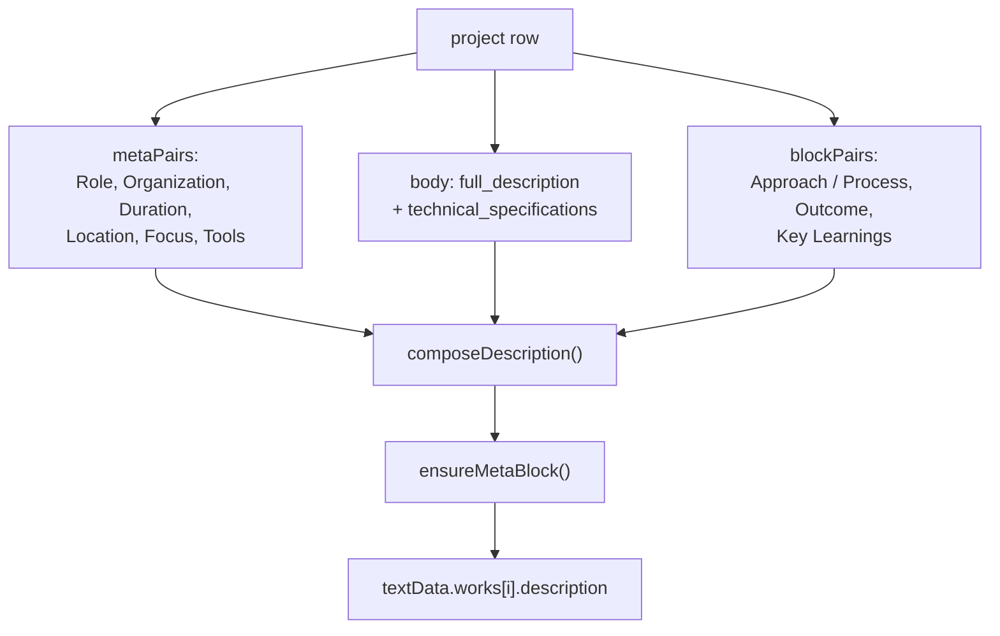
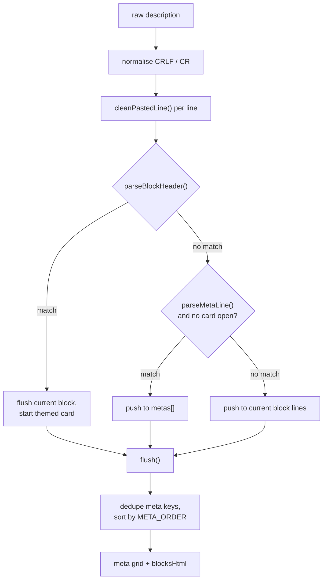
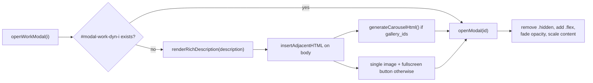

# Rendering

The public page has exactly one data path: database rows are flattened into a
legacy JSON shape, the shape is used to build strings, the strings are sanitised,
and the result is assigned to a container's `innerHTML`. This document covers the
whole path plus the two pieces of UI that are generated rather than static: the
works carousel and the work modal.

## 1. Rows to shape

`buildContentShape(input)` (`src/cms/shape.js:277-482`) takes arrays keyed by
table name plus a `settings` object and returns
`{textData, imgData, settingsData}`. It is plain ESM with no imports, so the
same function runs in the browser, in Node migration scripts, and in
`node --test` (`src/cms/shape.js:12-15`).

| Input table | Becomes | Notes |
|---|---|---|
| `profiles` (`is_primary` first) | `textData.hero`, `textData.about`, `imgData.profile_image` | `shape.js:284-286`, `301`, `432-442` |
| `projects` (sorted by API) | `textData.works[]` (if `include_in_works !== false`) | `shape.js:315-343` |
| `experiences` | `textData.works[]` (only if `include_in_works === true`) | `shape.js:345-373` |
| `project_media` | `imgData['wg{i}_{j}']` + `item.gallery_ids[]` | `shape.js:304-310`, `321-327` |
| `education` | `textData.education[]` with `period` / `institution` / `major` | `shape.js:421-425` |
| `skills` + `content_categories` (`kind = 'skill_group'`) | `textData.skills[]` with `category` / `icon` / `items` | `shape.js:382-411` |
| `organizations` | `textData.organizations[]` with `name` / `role` | `shape.js:427-430` |
| `gallery` | `textData.photography[]` with `title` / `image_id` | `shape.js:413-418` |
| `site_images` | `imgData[key] = url` | `shape.js:297-300` |
| `site_settings` (key/value rows) | `contact`, photography copy, `settingsData` | `shape.js:449-480` |
| `social_links` (`visible !== false`) | `contact.email` / `linkedin` / `instagram` | `shape.js:444-460` |
| `documents` (`is_active = true`) | CV anchors rewritten in the DOM | `public-content.ts:105-122` |
| `content_categories` | category name on each work card | `shape.js:334`, `364` |

Rules encoded in that file, and the reasons:

1. **Draft rows never leave the mapper** (`isPublished`, `shape.js:265-267`).
   Row Level Security already hides them; this is defence in depth.
2. **Works are ordered by `sort_order`, then `display_priority` descending, then
   `created_at`** (`shape.js:375-379`). Projects and experiences are merged into
   one carousel; the sort is the only thing keeping that merge stable.
3. **Image keys are synthesised, never derived from content**
   (`wm{i}`, `wg{i}_{j}`, `em{i}`, `eg{i}_{j}`, `gal{i}`). Keys are stable
   positions, so reordering rows reorders images with them.
4. **Text is passed through verbatim** where the author already wrote the legacy
   format. `composeDescription` refuses to merge meta lines into a description
   that is self-describing (`shape.js:126-145`), and `ensureMetaBlock` only adds
   the keys that are missing (`shape.js:178-188`).
5. **Tag-like fields tolerate the old `[{url,caption,alt}]` shape**
   (`labelOf`, `shape.js:54-62`). Without it those fields render as
   `[object Object]`.

## 2. Description composition

A work's modal body is not a single column. It is composed from multiple CMS
columns into one markdown-ish string, then parsed back out in the browser.



- `buildProjectDescription` (`shape.js:197-217`) and
  `buildExperienceDescription` (`shape.js:224-237`) are the only two composers.
- `durationText` normalises dates into `2024`, `2019` to `2022`, or `2026` to
  `Present` style text (`shape.js:79-86`). The separator inside a range is a
  single typed character, not a hyphen; regenerated fixtures copy it from
  `tests/shape.test.mjs:37-43` instead of retyping it.
- A description that starts with a meta line is left byte identical
  (`startsWithMetaLine`, `shape.js:151-160`). That is asserted in
  `tests/shape.test.mjs:72-80`.

## 3. Shape to DOM

`loadContentBundle()` (`index.html:1768-1791`) returns the shape; the renderer
then runs a flat list of paint blocks inside one `try` (`index.html:1793-2287`).
One thrown error aborts every later block, which is why the whole body is
wrapped and logged rather than allowed to break the page
(`index.html:2285-2287`).

| Container | Painter | Produces |
|---|---|---|
| `#cms-hero-title` / `-subtitle` / `-desc` | `index.html:1903-1931` | two escaped lines, subtitle text, typewriter description |
| `#cms-about-heading` / `-body` | `index.html:1934-1939` | `textContent` heading, `md()` body, alignment class |
| `#cms-education-container` | `index.html:1941-1950` | glass cards: period, institution, major |
| `#cms-skills-container` | `index.html:1952-1965` | one card per skill group, chips per item |
| `#cms-works-container` | `index.html:1974-2084` | full width slides + dots + counter + swipe |
| `#cms-photography-*` | `index.html:2157-2169` | 16:9 tiles with a blur backdrop and hover title |
| `#cms-orgs-container` | `index.html:2171-2179` | glass cards: name, role |
| `#cms-contact-*` | `index.html:2192-2201` | heading, `md()` body, three links via `safeHref()` |
| `.stat-counter` | `index.html:2180-2188` | rewrites `data-target` from real counts |

Two details that look like bugs but are intended:

- The stats block starts from hardcoded targets in markup
  (`index.html:1218-1227`) and is overwritten with `works.length` and
  `organizations.length` once content exists (`index.html:2184-2186`). The first
  counter is years since a hardcoded start year, not a CMS value.
- `imgData` is passed through `cleanUrl()` before any use
  (`index.html:1797`), so a `javascript:` URL in an image column cannot survive
  even if it reaches `src`.

## 4. `renderRichDescription`

`renderRichDescription(description)` (`index.html:1675-1762`) turns one string
into up to three outputs: a metadata grid, a sequence of block cards, and plain
markdown bodies. It is a line-oriented parser with a small amount of cleanup in
front of it.



### 4.1 Paste cleanup

`cleanPastedLine` (`index.html:1613-1620`) strips WYSIWYG leftovers that arrive
when an author pastes from a word processor: `Heading`/`List item`/`Body`
labels glued to the following word (`PASTE_LABEL`, `index.html:1609`), and lines
that are only a label (`PASTE_LABEL_ONLY`, `index.html:1610`). A line that
consists only of such a label is dropped.

### 4.2 Metadata grid

- Recognised keys: `role`, `organization`, `organisation`, `duration`, `period`,
  `focus`, `tools`, `location`, `award`, `organizer`, `team`, `year`
  (`index.html:1622`). The match is case-insensitive; `**bold**` wrappers are
  tolerated.
- Meta lines are lifted into the grid only **before** a card has started
  (`index.html:1696-1698`), so `Role:` mentioned inside an Outcome paragraph
  stays prose.
- Duplicate keys are dropped, first one wins (`index.html:1704-1710`), then the
  list is sorted into a canonical order so two cards never disagree about field
  order (`index.html:1713-1715`).
- Column count is `md:grid-cols-3` only when the count divides by three,
  otherwise `md:grid-cols-2` (`index.html:1719`). That avoids an orphan cell
  hugging the left edge of a three column grid.
- Values are rendered with `mdInline()` (`index.html:1721`), so a value may
  contain inline markdown but never a block element.
- The grid markup is one blurred, bordered panel
  (`bg-surface-container-lowest/30 backdrop-blur-md`,
  `index.html:1720`).

### 4.3 Themed block cards

`BLOCK_CARDS` (`index.html:1633-1639`) maps header aliases to a title, an icon,
and three Tailwind class fragments (text colour, border colour, background tint).

| Card | Header aliases | Icon | Accent |
|---|---|---|---|
| Problem | `problem`, `background`, `context` | `report_problem` | `text-error` |
| Approach / Process | `approach`, `approach / process`, `process`, `methodology`, `method` | `account_tree` | `text-primary` |
| Action | `action`, `actions`, `implementation`, `contribution`, `responsibilities` | `play_circle` | `text-primary` |
| Outcome | `outcome`, `outcomes`, `result`, `results`, `impact` | `verified` | `text-emerald-400` |
| Key Learnings | `key learnings`, `key learning`, `learnings`, `takeaways` | `lightbulb` | `text-amber-400` |

A header is recognised only when it is the whole line: `Action:`, `## Action`,
or `**Action**`, at most 42 characters (`parseBlockHeader`,
`index.html:1641-1650`). Card markup is a rounded panel with a 1px accent rail
on the left, an icon plus title as `h3`, and a `.md-body .md-body--card` body
(`index.html:1751-1758`).

`Key Learnings` gets one extra transform: a contiguous run of bare lines is
turned into a bullet list, and the transform stops at the next heading, rule,
bold title, short line ending in a colon, or line longer than 140 characters
(`index.html:1730-1744`). Without that stop condition, bullets swallowed the
rest of the document.

### 4.4 Markdown bodies

Everything that is not a header or a meta line becomes a block. Blocks are
normalised so that markdown can parse them: a blank line is inserted before a
heading or a list that interrupts prose (`normalizeMarkdown`,
`index.html:1653-1670`). Each block is rendered as
`<div class="md-body">...</div>` (`index.html:1748`).

## 5. Sanitisation

Two functions, applied in a fixed order. Both live in the renderer's closure.

| Step | Function | What it stops |
|---|---|---|
| Escape | `esc()` (`index.html:1553-1554`) | `<`, `>`, `&`, `"`, `'` in every interpolated string, including titles, tags, categories and image alt text |
| URL scrub | `cleanUrl()` (`index.html:1555-1560`) | control characters, quotes, backslashes; any scheme other than `http`, `https`, `mailto`, `data:image/` |
| Link guard | `safeHref()` (`index.html:1561-1564`) | anything that is not absolute, root relative, fragment, or scheme-less |
| HTML allowlist | `sanitizeHtml()` (`index.html:1565-1597`) | every element and attribute not in the allowlist |

The allowlist is deliberately small:

```text
elements: P BR STRONG EM B I DEL S CODE PRE BLOCKQUOTE UL OL LI
          H1..H6 HR TABLE THEAD TBODY TFOOT TR TH TD A IMG SPAN DIV
attributes: A -> href, title
            IMG -> src, alt, title
            TH, TD -> align
```

`sanitizeHtml` parses with `DOMParser` into an inert document, walks every
element, removes disallowed nodes and attributes, re-checks `href`/`src` against
a scheme allowlist, and returns `innerHTML` (`index.html:1571-1595`). It returns
`''` on any exception rather than falling back to the raw string
(`index.html:1596`).

`md()` and `mdInline()` (`index.html:1598-1599`) are `marked.parse` plus
`sanitizeHtml`. `marked` is vendored inline (`index.html:25-96`), with a
degenerate fallback if it failed to load (`index.html:1546-1548`).

**Contract for new markup:** strings are built with `esc()` around every
value, and any HTML fragment passes through `sanitizeHtml()` before it is
assigned. A new element needed in CMS content must be added to `ALLOWED`; the
function is never bypassed.

## 6. The works carousel

Markup skeleton (`index.html:1101-1120`):

```text
#works-slider-wrapper
  .overflow-hidden
    #cms-works-container.flex            <- slides, translated with a CSS transform
  #works-prev  #works-next               <- absolute round buttons
  #works-indicators  #works-counter      <- dots and "n / total"
```

- Each slide is `min-w-full flex-shrink-0` with a `min-h-[550px]` card
  (`index.html:2004-2005`), so the track is `N * 100%` wide and the move is
  `translateX(-N * 100%)` (`index.html:2062`).
- The card composition is fixed: category, title, tag string joined with `•`
  entities, `short_desc` clamped to two lines, and a `View Project` button that
  calls `openWorkModal(idx)` (`index.html:2024-2040`).
- The background is the cover image at 70% opacity with two gradient overlays
  (`index.html:2008-2017`). Without a cover, the renderer paints a category
  derived pattern instead (`index.html:1988-1997`).
- Dots are rebuilt on navigation, not re-created: `goToWorkSlide` rewrites each
  dot's class list (`index.html:2068-2072`).
- Touch: a horizontal delta over 50px advances or rewinds
  (`index.html:2079-2084`). There is no drag follow, unlike the gallery.
- The carousel is circular by design: `goToWorkSlide` wraps at both ends
  (`index.html:2059-2060`), so the arrow buttons are never disabled.

## 7. The work modal

`openWorkModal(idx)` (`index.html:2090-2153`) builds the modal lazily, once per
work, and caches it by id `modal-work-dyn-{idx}` in the document body.



- Shell: `.modal-overlay` at `z-[100]`, backdrop click closes, a fixed close
  button sits outside the scrolling area (`index.html:2117-2125`).
- Media header: if the work has `gallery_ids`, the modal embeds the shared
  carousel builder; otherwise one image with a blur backdrop is used
  (`index.html:2126-2135`).
- Body order is fixed: category, title, tags, metadata grid, themed cards
  (`index.html:2138-2146`).
- `openModal` / `closeModal` are globals (`index.html:2633-2668`). They toggle
  `hidden`/`flex`, force a reflow before the opacity transition
  (`index.html:2639`), and lock `body.overflow`. `closeModal` restores overflow
  after the 300ms transition, not immediately (`index.html:2661-2665`).
- The modal body alignment reads `textData.settings?.text_alignment`
  (`index.html:2092`), which **is never provided** by the shape
  (`shape.js:473-474` deliberately omits a `settings` object), so the fallback
  `text-left md:text-justify` always wins. Site wide alignment is applied to
  `#cms-about-body` instead (`index.html:1938`).

### 7.1 Inside the modal: the documentation carousel and lightbox

`generateCarouselHtml(mainImageId, galleryIds, containerId, extraClasses)`
(`index.html:1831-1889`) builds a horizontal snap strip:

- one slide, `min-w-full aspect-[16/9]`, with a blurred copy of the image behind
  an `object-contain` copy (`index.html:1862-1867`);
- arrows call `scrollCarousel(containerId, direction)`, which scrolls by exactly
  one container width (`index.html:1814-1820`);
- the counter is derived from `scrollLeft / clientWidth` on the `scroll` event
  (`index.html:1822-1829`);
- resolved image URLs are also stored in `window.__workMediaSets[containerId]`
  so the lightbox can read the set without JSON inside attributes
  (`index.html:1843-1845`).

The lightbox (`index.html:2669-2815`) is one lazily created overlay reused by
every carousel:

| Behaviour | Implementation |
|---|---|
| Trigger | delegated `click` on `.media-fs-btn` (`index.html:2794-2813`) |
| Multi image start index | `Math.round(scrollLeft / clientWidth)` read at click time (`index.html:2805-2807`) |
| Single image | `data-lb-src` attribute (`index.html:2811-2812`) |
| Keyboard | `Escape`, `ArrowLeft`, `ArrowRight`, capture phase, removed on close (`index.html:2745-2760`, `2782`) |
| Stacking | `.wl-overlay` is `z-index: 1200`, above the modal's `z-[100]` (`index.html:813`) |
| Focus | close button focused on open, trigger refocused on close (`index.html:2775`, `2784-2786`) |
| Body scroll | previous `overflow` saved and restored, not reset (`index.html:2769`, `2783`) |

## 8. Typography contract: `.md-body`

Because the page uses the Tailwind CDN, `prose` classes do not exist. All
markdown typography is the hand-written `.md-body` block
(`index.html:651-771`), and every CMS markdown surface must carry the class:

| Surface | Class |
|---|---|
| About body | `#cms-about-body.md-body` (`index.html:1076`) |
| Contact body | `#cms-contact-body.md-body` (`index.html:1237`) |
| Modal description blocks | `.md-body` per block (`index.html:1748`) |
| Inside a themed card | `.md-body.md-body--card` (`index.html:1757`) |

The rules that define it:

| Element | Rule |
|---|---|
| base | 16px, `line-height: 1.75`, `--color-on-surface-variant` (`index.html:658-662`) |
| first / last child | margins collapsed to zero (`index.html:663-664`) |
| `h1` | 1.45rem |
| `h2` | 1.125rem, bottom border in `outline-variant` (`index.html:679-683`) |
| `h3` / `h4` | 1.025rem / 0.975rem |
| `h5` / `h6` | 0.8rem, uppercase, `0.09em` tracking, primary colour (`index.html:686-692`) |
| lists | disc / decimal, nested circle and lower-alpha, markers in primary (`index.html:693-701`) |
| `strong` | `--color-on-surface`, weight 700 |
| `a` | primary colour, underlined, 2px underline offset |
| `blockquote` | 3px primary left rail, italic |
| `code` | Courier Prime, tinted `surface-container-high` background |
| `pre` | bordered, scrollable, rounded 0.75rem |
| tables | full width, collapsed borders, tinted header row (`index.html:740-757`) |
| images | `max-width: 100%`, 0.75rem radius |

`.md-body--card` (`index.html:762-771`) exists because a themed card already
owns its `h3` title: nested `h2` becomes a compact sub-heading with a primary
left rail instead of a full width underline.

## 9. Regression surface

Everything in this document is exercised by at least one browser assertion:
section counts and the modal body in `tests/public-smoke.mjs:91-113`, description
composition in `tests/shape.test.mjs:72-118`. A change to the shape, the
composers, or the card grammar requires running both.