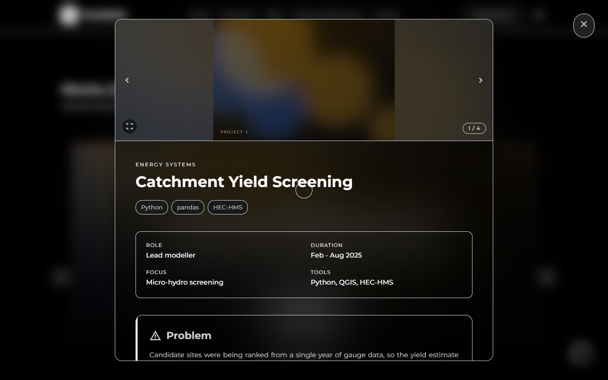
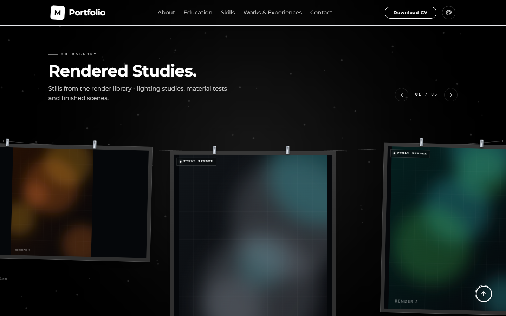
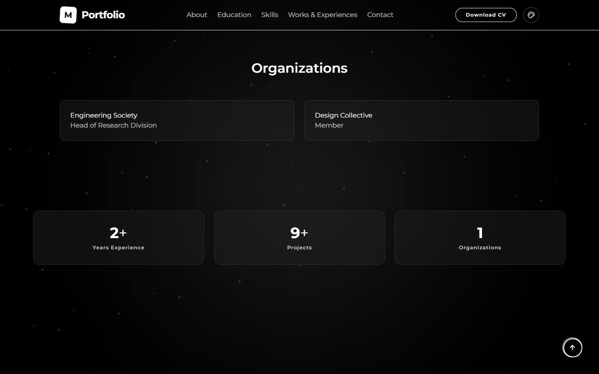

# Screenshot tour

Ten captures that document the structure of the page. They are not decoration:
each one is the fastest way to see whether a change broke a section's layout,
spacing, or stacking. Nothing in them depends on who the site belongs to, and the
captions describe structure and behaviour only.

All captures use the default theme (the page applies its default stored theme on
load, see `index.html:2332`), a fully dismissed loader, and settled content. Any
capture taken earlier will show an empty page: the loader keeps `#app-content` at
`opacity-0` until it is dismissed (`index.html:949`, `1487-1491`).

## 1. Hero

The first screen is a full-height section with a centred, two-line title, a
subtitle, and a third line rendered by a typewriter effect with a blinking caret.
Two buttons follow: a filled primary action with a download icon and an outlined
secondary action that jumps to the works section. Behind the text sits a canvas
particle field with connection lines; it is paused whenever the hero scrolls out
of view. There is no visible navigation on desktop beyond the top bar, and the
hero itself has no card or border, which is why it reads as empty space with
type.

## 2. About and education

A twelve-column grid: a 4:5 portrait frame on the left (the only element with a
3D tilt-on-hover behaviour), and on the right a section heading with a short
primary-coloured rule, then markdown body text. Below, the education block is a
two-column grid of glass cards, each with a small caps period line in the accent
colour, an institution heading, and a major line. The cards share a hover lift
and border glow; on a still capture you should still see the panel blur and the
hairline border.

## 3. Skills

Three columns of equal-height cards, one per skill group. Each card has a
Material Symbols icon at 32px, a group title, and a wrapped row of pill chips.
Chips are one of the few elements with their own hover state (scale plus accent
border), and the card uses the animated conic gradient border that only appears
on hover. Notice that the cards are transparent rather than filled: the gradient
border and the backing blur are doing the separation work.

## 4. Works carousel

One slide fills the carousel viewport: a full-bleed cover image at reduced
opacity, two stacked gradients for legibility, and a centred glass panel holding
five stacked pieces of information in a fixed order (category overline, title,
tag string, one-line summary, call to action). The slide has a minimum height, so
on wide screens the panel stays vertically centred rather than hugging the
content. Outside the slide you should see round previous/next buttons that
overlap the edges; the dot indicator row and the `n / total` counter sit below
them, which on a short viewport lands just outside the frame. Only one slide is
visible at a time; the track is translated, not scrolled, so there is no visible
scrollbar.

## 5. Work modal

The modal is a centred panel with its own scroll area, a fixed close button
outside that area, and a dimmed, blurred backdrop. Top to bottom: a media header
(image or, when the work has extra media, a swipeable strip with a counter and a
fullscreen button), the category overline, the title, a row of tag pills, then a
bordered metadata grid (two or three columns depending on field count), then the
composed body. Body sections that match the block grammar appear as tinted cards
with an icon, a title, and a coloured rail on the left edge; everything else is
plain markdown. Headings inside cards are smaller than the document headings and
carry a short accent rail.

## 6. Photography

A three-column grid of 16:9 tiles. Each tile layers a blurred, scaled copy of the
image behind an `object-contain` copy, so portrait photos letterbox into the
matte instead of being cropped. A caption overlay fades in on hover. The section
heading and description above the grid are CMS copy, written with
`textContent`, which is why they never contain markup.

## 7. Motion gallery

A clothesline pinned between two points, drawn as an SVG curve that sags in the
middle, with two small clip marks above each print. Prints hang from their top
edge at slightly different angles, sized so the active one is largest; the
neighbours stay partially visible on both sides, which is what communicates that
the row continues. Each print shows a badge (media type) and a caption block
(project overline, title, quiet metadata line). Above the stage: an eyebrow, a
heading, a subtitle, a `01 / 06` counter and two round arrow buttons. Below it:
a row of tick indicators and a drag hint. Nothing is cropped: a portrait clip
hangs as a tall narrow print, a wide clip as a short wide one.

## 8. 3D renders gallery

The same clothesline design, second instance on the page. The difference is
behavioural, and visible in a still: no play control on any print, because these
are stills. Badges are absent from this gallery's content type, so the print is
just paper, matte and image. Sizing rules are identical, which is the point: the
two sections share one class and must stay visually consistent.

## 9. Organizations, stats and contact

Organizations is a two-column grid of glass cards with a name and a role line.
Below it, three stat panels count up when they scroll into view; the numbers are
rewritten from real content counts at render time, so the visible digits should
match the number of works and organizations on the page. The contact section is a
single wide glass panel with a heading, markdown body, and three link rows
separated by vertical hairlines on desktop. The whole bottom block sits on the
lowest surface step, which is why the panels read as inset rather than raised.

## 10. Mobile hero

At 390px the desktop nav is replaced by a slim header with a logo mark and a
menu button; the menu itself is an off-canvas panel that slides in from the
right and contains the same links plus a theme picker grid. The hero title drops
to the mobile type scale, the two actions stack full width, and the particle
canvas still runs behind the text. Nothing overflows horizontally: the page sets
`overflow-x-hidden`, and the gallery sections are laid out from measured widths
rather than fixed sizes.

## Capture notes

| Requirement | Detail |
|---|---|
| Viewport | desktop 1440x900, mobile 390x844 (`isMobile`, `hasTouch` for the mobile shot) |
| Loader | wait until `#loader` has `display: none` (it self-dismisses after about 2.3s, or click it) |
| Content | wait for `#cms-works-container > div` to exist before capturing section 4 |
| Galleries | scroll the section into view and wait for the entrance: `.mf-print` elements reach full opacity after roughly 1.6s plus a 72ms stagger per print |
| Scroll state | capture each section with its top edge clear of the fixed header so the heading is visible |
| Theme | leave the stored theme untouched; do not force one for the tour |

The exact file list, sections and readiness conditions are in
[images/MANIFEST.md](images/MANIFEST.md).