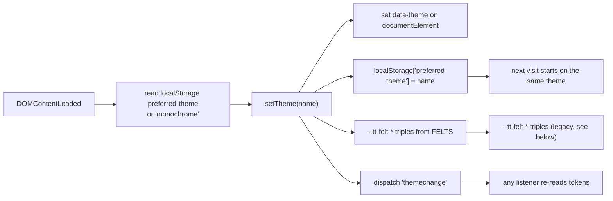

# Theming

The page has two token layers and one rule: the first layer holds values, the
second layer only aliases them into Tailwind utility names. Themes are pure
value swaps on `[data-theme]`. Nothing else in the CSS knows which theme is
active.

## 1. The paragraph you need before touching markdown

The page loads Tailwind from `cdn.tailwindcss.com` (`index.html:24`), and the CDN
build accepts only an inline `tailwind.config` object (`index.html:102-179`); it
cannot load a config file and cannot register plugins, so `@tailwindcss/typography`
is unavailable and every `prose` / `prose-invert` class in this page is a no-op.
Markdown is therefore styled by the hand-written `.md-body` stylesheet
(`index.html:651-771`), which is the only reason headings, list markers, block
quotes and tables look like prose at all. If you add a markdown construct, style
it in `.md-body`; adding a `prose-*` class will silently do nothing.

The root `tailwind.config.js` (`tailwind.config.js:1-91`) and
`src/style.css` are leftovers from a PostCSS build that the public page does not
use. Treat them as reference, not as the source of truth.

## 2. Layer one: value tokens

Defined on `:root, [data-theme="forest"]` and then overridden per theme
(`index.html:188-301`, `541-605`). The naming follows Material 3 semantics:
a role name describes where a colour is used, not what colour it is.

| Token | Role |
|---|---|
| `--color-primary` | the accent: links, icons, active states, headings |
| `--primary-rgb` | the same accent as `r, g, b`, for `rgba()` in gradients and canvas |
| `--color-primary-container` | filled accent surface (button background, glow) |
| `--color-on-primary` | text on a filled accent |
| `--color-on-primary-container` | text on the accent container |
| `--color-background`, `--color-surface` | page background |
| `--color-surface-container-lowest` .. `-highest` | five elevation steps for panels, cards, modals |
| `--color-on-surface` | primary text |
| `--color-on-surface-variant` | secondary text, captions, markdown body |
| `--color-outline` | lines, pegs, dividers |
| `--color-outline-variant` | hairlines and low emphasis borders |
| `--color-inverse-surface` | text that must contrast with `surface` (used for card titles) |
| `--color-inverse-on-surface` | the inverse of the above |
| `--color-surface-dim` | dimmed surface |

`--primary-rgb` exists because `rgba(var(--primary-rgb), 0.4)` is used in glows,
shadows, the spotlight and two canvases (`index.html:319`, `325`, `378`,
`2319`). A theme without it renders those effects black or invisible.

## 3. The eight themes

All values from `index.html:188-605`. Only the three most structural colours are
listed; every theme defines the full set.

| Theme key | Label in UI | `primary` | `background` | `on-surface` |
|---|---|---|---|---|
| `forest` | Forest (also `:root`) | `#4edea3` | `#0b1326` | `#dae2fd` |
| `light` | Light Mode | `#006c49` | `#f8fafc` | `#0f172a` |
| `aleksandria` | Aleksandria | `#d4af37` | `#fdf5e6` | `#3e2723` |
| `glacier` | Glacier | `#00d4ff` | `#020617` | `#e0f2fe` |
| `neon-tokyo` | Neon Tokyo | `#ff007f` | `#0a0118` | `#f0fdfa` |
| `abyss` | Abyss | `#00e5ff` | `#001219` | `#e0f2fe` |
| `sunset` | Sunset | `#ff6b6b` | `#2b0b1e` | `#fee2e2` |
| `monochrome` | Monochrome | `#ffffff` | `#000000` | `#ffffff` |

Notes:

- Five themes live in `<style id="theme-vars">` (`index.html:181-305`); the last
  three live in a second, unnamed `<style>` block (`index.html:541-605`). If you
  add a theme, add it next to the others in the same block you are editing, and
  keep the two blocks consistent in which block owns which.
- The document starts as `<html class="dark scroll-smooth">` with no
  `data-theme` (`index.html:1`), so `forest` (bound to `:root`) is the
  pre-JavaScript appearance. JavaScript then applies `monochrome` as the default
  choice when nothing is stored (`index.html:2332`).
- `dark:` variants are active in every theme, including `light`, because
  `darkMode: "class"` (`index.html:104`) and the class never changes
  (`index.html:1`). Do not use `dark:` to express "dark theme"; use a token.

## 4. Layer two: Tailwind aliases

The CDN config maps utility names onto the variables (`index.html:107-155`):

```js
colors: { "surface-container-high": "var(--color-surface-container-high)", ... }
```

So `bg-surface-container-high` compiles to
`background-color: var(--color-surface-container-high)` in the generated
stylesheet, and the value still comes from the active theme. There is no second
palette to maintain: adding a colour means adding a variable and, if you want a
utility name for it, one alias line.

The same block defines the rest of the scale (`index.html:156-175`):

| Group | Values |
|---|---|
| `borderRadius` | `DEFAULT 1rem`, `lg .5rem`, `xl .75rem`, `full 9999px` |
| `spacing` | `section-gap 120px`, `base 8px`, `margin-desktop 64px`, `margin-mobile 20px`, `gutter 24px`, `container-max 1280px` |
| `fontFamily` display/body/label roles | Montserrat |
| `fontFamily.typewriter` | Courier Prime, Courier New, monospace |
| `fontSize.display-lg` | 64/72, `-0.02em`, 700 |
| `fontSize.display-lg-mobile` | 40/48, `-0.01em`, 700 |
| `fontSize.headline-md` | 32/40, 600 |
| `fontSize.headline-sm` | 24/32, 600 |
| `fontSize.body-lg` | 18/28, 400 |
| `fontSize.body-md` | 16/24, 400 |
| `fontSize.mono-technical` | 14/20, 500 |
| `fontSize.label-caps` | 12/16, `0.1em`, 600 |

Because `borderRadius.DEFAULT` is `1rem`, a bare `rounded` is a 16px radius, and
`rounded-lg` is *smaller* than `rounded` here. That inversion is intentional in
the original design and is easy to trip over.

## 5. How a theme is applied



`setTheme` is a global (`index.html:2301-2329`) and is also used to keep
`--primary-rgb` in sync for the particle canvas (`index.html:2305-2308`). Every
`.theme-btn` carries `data-set-theme` and calls it (`index.html:2335-2346`);
there are two switchers, one in the desktop nav (`index.html:974-998`) and one in
the mobile menu (`index.html:1025-1032`), so a new theme needs a button in both.

The `FELTS` table (`index.html:2312-2321`) still writes a three-step palette to
`--tt-felt-light|mid|deep` on every theme change. It was built for the old
turntable view, which has been replaced by the hanging-print gallery
(`index.html:1173-1175`), so nothing consumes those variables today. Keep the
table in sync when adding a theme, or delete it and the writes together; a
half-removed theme entry is a silent fallback to `monochrome`
(`index.html:2322`).

## 6. Composition patterns in use

| Pattern | Where | Why |
|---|---|---|
| `color-mix(in srgb, var(--color-x) N%, transparent)` | `.glass-panel`, `.md-body` borders, gallery tokens | one variable yields every opacity step without extra tokens (`index.html:313-316`, `682`) |
| `rgba(var(--primary-rgb), a)` | glow, spotlight, dots, shadows | CSS gradients cannot use `color-mix` in every target the page supports (`index.html:319`, `325`) |
| `bg-surface/70` and friends | nav, footer, overlays | Tailwind's slash opacity works on aliased colours because the alias is a plain `var()` |
| `text-inverse-surface` | card titles on a dark panel | matches the surface, not the theme's "mode" (`index.html:1946`) |

## 7. Adding or changing a colour

1. Add the variable to **every** theme block (`index.html:188-301` and
   `541-605`). A token defined in only one theme resolves to nothing elsewhere.
2. Add the Tailwind alias in `index.html:107-155` if you want a utility name.
3. If the colour drives canvas or gradients, add the `-rgb` companion too.
4. Check the page in at least `forest`, `light` and `monochrome`: those three
   cover dark, light and pure contrast.
5. Run `node tests/public-smoke.mjs` (it fails on console errors, which is how a
   broken token usually surfaces) and `node tests/render3d-gallery.mjs` if the
   gallery plate is involved.

Never write a raw hex outside a theme block. The gallery is the model to copy:
it declares scoped `--mf-*` tokens that are *derived* from the site tokens
(`motion-gallery.css:9-18`), so it re-themes for free.

## 8. Known token hazards

| Hazard | Detail |
|---|---|
| Undefined token family | `var(--md-sys-color-*)` is used 10 times in `index.html` (scrollbar at `:185`, work patterns at `:1990-1996` and `:2100-2106`) and defined nowhere. Those declarations are invalid and dropped, so those surfaces fall back to transparent. |
| Split theme blocks | Three themes are defined far from the other five (`index.html:541-605`). Grep for `[data-theme=` before assuming a theme does not exist. |
| CDN scanning | The CDN build generates utilities from class strings it sees in the document. A class assembled at runtime (`'text-' + x`) never matches. All dynamic classes in this project are literals inside template strings. |
| `!important` cursor lock | `@media (pointer: fine) { * { cursor: none !important } }` (`index.html:468-472`) disables every other cursor, including the gallery's `cursor: grab` (`motion-gallery.css:150`). The custom cursor dot replaces it. |
| `content-visibility: auto` on sections | `index.html:648` lets the browser skip off-screen layout. It is why a freshly navigated section can measure as zero height for one frame; the gallery works around it with `ResizeObserver` (`motion-gallery.ts:518-523`). |